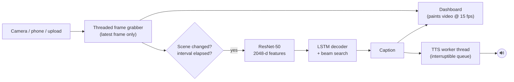
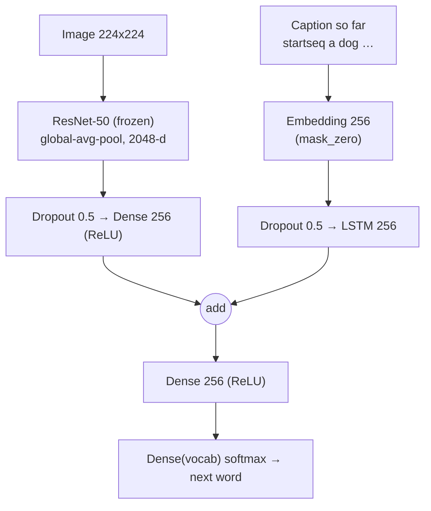

# ◉ VisionVoice

**Image caption generator with voice output for the visually impaired.**
Point a camera at the world; VisionVoice describes the scene in one sentence and speaks it aloud, entirely on your own machine.

`ResNet-50 encoder` → `Embedding + LSTM decoder (merge architecture)` → `beam search` → `offline text-to-speech`

---

## Features

| | |
|---|---|
| **Model** | ImageNet ResNet-50 (frozen, cached features) + 256-unit LSTM merge decoder trained on Flickr8k |
| **Live input** | Local webcam, phone IP-camera stream (Android *IP Webcam*, DroidCam, any MJPEG/RTSP URL), browser camera over WebRTC, or an uploaded photo |
| **Voice** | Offline TTS (`pyttsx3`, with OS-command fallback) on its own thread; a new caption interrupts the old one and duplicates are never repeated |
| **Dashboard** | Dark luxury Streamlit UI, 3 themes incl. a yellow-on-black high-contrast mode, live caption text scaling (20-96 px), interface scale (85-150 %), reduce-motion switch, animated audio waveform while speaking, `aria-live` caption region |
| **Analytics** | Plotly charts: BLEU-1..4, training/validation loss, per-caption latency split (CNN vs decoder), beam-width benchmark, CSV export of the session log |
| **Fast by design** | Threaded latest-frame grabber, caption worker decoupled from the UI, scene-change gating, `tf.function` graphs with fixed signatures (no retracing), JPEG-encoded display frames |

## How it works





Training only updates the small decoder: ResNet-50 features are computed **once** and cached to `outputs/cache`, and training pairs (`prefix → next word`) are generated on the fly by a `tf.data` pipeline.

## Project structure

```
visionvoice/
├── app.py                  # Streamlit dashboard
├── train.py                # training + BLEU + latency benchmark -> outputs/
├── config.py               # hyper-parameters, paths, vocabulary & live-stream settings
├── model.py                # ResNet-50 encoder, LSTM decoder, CaptionGenerator (greedy/beam)
├── utils/
│   ├── data_pipeline.py    # Flickr8k parsing, cleaning, vocabulary, feature cache, tf.data batches
│   ├── audio_engine.py     # non-blocking offline text-to-speech
│   ├── video_stream.py     # threaded webcam / IP-camera reader
│   └── live_captioner.py   # background caption worker with scene-change gating
├── tests/test_pipeline.py  # unit tests (no TensorFlow required)
├── data/flickr8k/          # <- put the dataset here (git-ignored)
├── outputs/                # models, caches, metrics (git-ignored)
├── .streamlit/config.toml  # dark base theme
├── requirements.txt
└── .gitignore
```

## Installation

Requires **Python 3.10 - 3.13**.

```bash
git clone https://github.com/<your-username>/visionvoice.git
cd visionvoice

python -m venv .venv
source .venv/bin/activate            # Windows (PowerShell): .venv\Scripts\Activate.ps1
pip install -r requirements.txt
```

* **NVIDIA GPU?** replace `tensorflow-cpu` with `tensorflow` in `requirements.txt` before installing.
* **Voice on Linux** needs eSpeak: `sudo apt install espeak-ng`. Windows (SAPI5) and macOS work out of the box.
* Check your voice: `python -m utils.audio_engine "A dog runs across the grass"`

## Get the dataset

1. Download **Flickr8k** (images + captions), e.g. the Kaggle mirror *"adityajn105/flickr8k"* or the original release from the University of Illinois.
2. Extract everything into `data/flickr8k/`. Both layouts are detected automatically:
   * classic: `Flicker8k_Dataset/*.jpg`, `Flickr8k.token.txt`, `Flickr_8k.{train,dev,test}Images.txt`
   * Kaggle: `Images/*.jpg`, `captions.txt` (a seeded 6000/1000/1000 split is used when the split files are absent)

## Train

```bash
python train.py                     # full run, early stopping on validation loss
python train.py --epochs 10 --beam 3
python train.py --limit 300         # quick smoke test on 300 images
```

Outputs in `outputs/`: `models/caption_model.keras`, `models/vocab.json`, `training_history.json`, `metrics.json` (BLEU-1..4 and latency). The first run spends most of its time extracting ResNet-50 features (minutes on a GPU, longer on CPU); later runs reuse the cache. All hyper-parameters live in `config.py`.

Your BLEU scores depend on your run; a merge-style captioner of this size on Flickr8k typically lands in the BLEU-1 ~0.55-0.62 range.

## Run the dashboard

```bash
streamlit run app.py
```

Open <http://localhost:8501>. Pick an input source in the sidebar and switch on **Start live stream**.

### Using a phone camera

| Method | Steps |
|---|---|
| **IP camera app (easiest)** | Install *IP Webcam* (Android) or *DroidCam*. Start its server, keep phone and computer on the same Wi-Fi, then choose **Phone / IP camera** and enter the address shown in the app, e.g. `192.168.1.8:8080` (completed to `/video`). Full URLs such as `rtsp://…` also work. |
| **Browser / WebRTC** | Choose **Browser camera (WebRTC)** and press *START*. Opening the dashboard from a phone requires HTTPS (browsers block camera access otherwise): run `streamlit run app.py --server.sslCertFile cert.pem --server.sslKeyFile key.pem`, or tunnel with `cloudflared`/`ngrok`. On the computer itself `localhost` works without HTTPS. |
| **USB webcam** | Choose **Webcam** and set the camera index (usually `0`). |

Speech is produced by the machine that runs the app, so with a remote phone the voice plays on the computer's speakers.

### Dashboard controls

* **Capture & describe** - captions the current frame immediately and stores it under *Snapshots*.
* **Repeat caption / Stop voice** - replay or silence the speaker.
* **Beam width** (1 = fastest), **minimum seconds between captions** and **scene-change threshold** tune latency versus chattiness.
* **Caption text size**, **Interface scale**, **Colour theme**, **Reduce motion** adapt the UI instantly.

## Tests

```bash
pytest -q
```

## Troubleshooting

| Symptom | Fix |
|---|---|
| "The model has not been trained yet" | Run `python train.py` after placing the dataset. |
| "No text-to-speech engine could be started" | Linux: `sudo apt install espeak-ng`. Captions still display. |
| "Camera opened but delivered no frames" | Check the index/URL, that no other app holds the camera, and that phone and PC share a network. |
| Captions feel slow | Lower the beam width to 1-2, or install GPU TensorFlow. |
| Out of memory while training | Lower `BATCH_SIZE` or `SHUFFLE_BUFFER` in `config.py`. |

## Push this project to a new GitHub repository

1. Create an **empty** repository on GitHub (no README, no .gitignore, no licence) named e.g. `visionvoice`.
2. In the project folder:

```bash
git init
git add .
git status                      # confirm data/ and outputs/ are NOT listed
git commit -m "Initial commit: VisionVoice image captioning with voice output"
git branch -M main
git remote add origin https://github.com/<your-username>/visionvoice.git
git push -u origin main
```

Using SSH? `git remote add origin git@github.com:<your-username>/visionvoice.git`.
Using the GitHub CLI instead? `gh repo create visionvoice --public --source=. --remote=origin --push`.

Later updates: `git add . && git commit -m "Describe your change" && git push`.

> Trained weights (`*.keras`) and the dataset are git-ignored on purpose. To share weights, publish them as a GitHub Release asset, or track them with [Git LFS](https://git-lfs.com) (`git lfs track "*.keras"`) after removing `*.keras` from `.gitignore`.

## Acknowledgements

Flickr8k dataset (Hodosh, Young & Hockenmaier, 2013) - follow its usage terms. ResNet-50 weights from Keras Applications (ImageNet).
